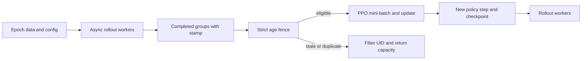
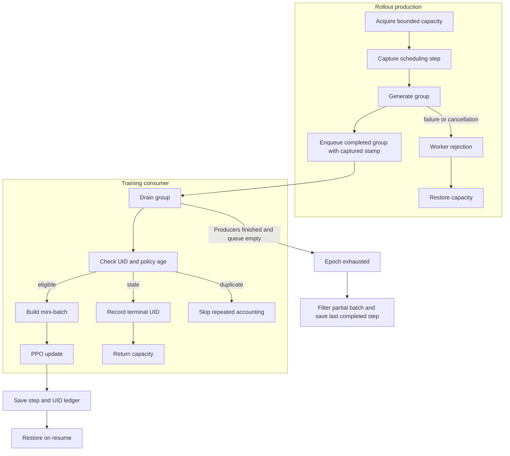

# Async RL training with strict policy-age fencing

This project adds opt-in strict policy-age fencing and a bounded pretrained-model reference run to the complete Apache-2.0 [SkyRL](https://github.com/NovaSky-AI/SkyRL) framework. It preserves the full upstream source and history at commit `b3046522ffb63738eed75a9f4853b92cc161b0ff`, all licenses and notices, distributed trainers, generators, and examples. The original [upstream README](README.upstream.md) is preserved verbatim.

The coursework source is [Asynchronous Agentic Reinforcement Learning](https://people.eecs.berkeley.edu/~kubitron/courses/cs262a-F25/projects/reports/project1008_paper_ver2_72488057446561351955.pdf), by Charlie Ruan, Hanchen Li, and Jiaxiang Yu for Berkeley CS262a Fall 2025. The [official fully async tutorial](https://docs.skyrl.ai/docs/tutorials/fully_async) describes the framework mechanism. This checkout is based on current official SkyRL, not a verified copy of the students' exact experimental branch. Their scaling-law and throughput experiments have not been reproduced.

## Contents

- [Architecture and execution guide](#architecture-and-execution-guide)
- [Resource-light quality repair](#resource-light-quality-repair)
- [Enable strict fencing in SkyRL](#enable-strict-fencing-in-skyrl)
- [Run the local pretrained reference](#run-the-local-pretrained-reference)
- [Verify changes](#verify-changes)
- [License](LICENSE)

## Architecture and execution guide

This repository retains SkyRL and adds opt-in strict age checks to the fully asynchronous PPO trainer, plus a separate bounded local reference. The native trainer uses distributed rollout and training backends; the local reference reuses the fence with a small frozen Qwen model. It does not validate native distributed execution. A [rollout group](#rollout-group) carries a UID and scheduling stamp through the [policy age](#policy-age) check.

The top-level flow separates producers from the training consumer. Eligible groups reach PPO; stale and duplicate groups do not.



The inner lifecycle shows capacity and checkpoint boundaries. Stale UIDs become terminal for the epoch; exhaustion filters a partial final mini-batch.



| Subsystem | Responsibility and owned state | Source |
| --- | --- | --- |
| Fence | Validates UIDs and step values, then classifies a group as keep, stale, or duplicate. | [`staleness.py`](skyrl/train/staleness.py) |
| Staleness manager | Tracks submitted, accepted, filtered, and running groups and gates producer capacity. | [`fully_async_trainer.py`](skyrl/train/fully_async_trainer.py) |
| UID ledger | Tracks consumed and filtered data across epoch reset and checkpoint reload. | [`fully_async_trainer.py`](skyrl/train/fully_async_trainer.py) |
| Native trainer | Starts per-epoch workers, drains groups, builds batches, updates policy, and saves checkpoints. | [`fully_async_trainer.py`](skyrl/train/fully_async_trainer.py) |
| Local reference | Drives the cached model and checks retained bounded-run evidence. | [`train.py`](examples/local_async/train.py), [`verify_async_rl.py`](scripts/verify_async_rl.py) |
| Regression checks | Cover boundaries, duplicates, exhaustion, capacity, and checkpoint behavior without native imports. | [`test_staleness.py`](tests/local_async/test_staleness.py), [`test_checkpoint_boundary.py`](tests/local_async/test_checkpoint_boundary.py) |

Execution journey:

1. SkyRL creates per-epoch dataloader state, bounded producer capacity, and rollout workers.
2. A worker acquires capacity and captures the current scheduling step before generation. It enqueues the completed [rollout group](#rollout-group) with that stamp.
3. The consumer drains the group and checks its UID and [policy age](#policy-age) against the current update step.
4. Strict mode trains eligible groups. A stale group records a [terminal UID](#terminal-uid) and returns capacity; duplicate delivery does not repeat these effects.
5. The trainer builds PPO input and updates the policy. At exhaustion, strict mode filters an incomplete mini-batch and may complete fewer updates.
6. Checkpoints save the last completed step and UID ledgers. Resume restores filtered UIDs, including after zero updates. Worker failures propagate instead of leaving the consumer waiting indefinitely.

| Choice | Current behavior and rationale inferred from code | Alternative and cost to reconsider |
| --- | --- | --- |
| Make strict mode opt-in | `strict_staleness=false` keeps warning-only admission for existing runs. | Changing the default alters training data and update counts. |
| Stamp the scheduling step | Conservatively bounds oldest policy age through a group's generation. | Per-token stamps are more precise but add metadata and group-loss complexity. |
| Make stale UIDs terminal per epoch | Prevents regeneration and makes duplicate deliveries idempotent. | Retrying under a new UID may repeat stale work and changes data accounting. |
| Return capacity on terminal outcomes | Keeps producer accounting bounded as groups finish, fail, or are filtered. | Delayed release can stall producers; loose accounting can exceed configured capacity. |
| Filter partial final batches | Preserves configured batch semantics but can reduce updates at exhaustion. | Training partial batches uses more samples but changes optimizer batch behavior. |
| Keep local reference separate | Demonstrates mechanics on one GPU without implying native distributed validation. | Combining its result with native evidence would overstate backend coverage. |

These are implementation tradeoffs, not recorded historical intent. The local run does not establish native throughput or general model quality.

<a id="rollout-group"></a>

<details><summary>What is a rollout group?</summary>

A rollout group holds generated trajectories for one training UID. The local reference samples two trajectories per group.

</details>

<a id="policy-age"></a>

<details><summary>What is policy age?</summary>

Policy age is the difference between the current update step and a group's scheduling stamp. At a maximum age of one, age one is accepted and older groups are stale.

</details>

<a id="terminal-uid"></a>

<details><summary>What is a terminal UID?</summary>

A terminal UID is data that this epoch must not generate or consume again. Strict stale filtering records it for duplicate handling and checkpoint resume.

</details>

<a id="capacity-accounting"></a>

<details><summary>What is capacity accounting?</summary>

Capacity accounting tracks submitted, accepted, filtered, and running groups against the producer limit. The manager checks their balance at epoch end.

</details>

<a id="partial-mini-batch"></a>

<details><summary>What is a partial mini-batch?</summary>

A partial mini-batch has fewer eligible groups than configured when generation ends. Strict mode filters this tail, so an epoch may train fewer steps.

</details>

## Resource-light quality repair

On a separate [fresh wider-operand holdout](docs/fresh-head-holdout-20261024.md), the five frozen, validation-selected clipped heads averaged **49.91% expected correct-answer probability versus 40.20%** for the initial head across 256 new arithmetic pairs. Every seed improved. The evaluation took 61.50 seconds and 1.42 GiB peak Torch CUDA allocation. This is a constrained tool-and-digit policy expectation, not general model accuracy or 1,280 independent questions.

The [24 October head-quality comparison](docs/head-quality-20261024.md) fixes oversized local head updates with native gradient-norm clipping. Across five seeds, validation-selected policies increased mean expected correct-answer probability from **56.29% to 64.33%** and expected reward from **0.758882 to 0.886297** on ten reused held-out arithmetic pairs. These are constrained-policy expectations, not general LLM accuracy or fifty independent questions. The original negative sync/async study remains below.

The complete ten-run CPU sweep used one thread, **7.27 seconds** before receipt writing and **611 MiB** peak parent memory. It reused frozen pretrained features without loading the model. A separate model/logit evaluation took 16.77 seconds and about 1.43 GiB of Torch CUDA allocation. The report retains all seeds, 30 checkpoint hashes, model-logit checks, resources and reproducible commands. No distributed throughput or speedup is claimed.

## Enable strict fencing in SkyRL

Use the existing fully async entrypoint and normal model, data, and cluster configuration. Add `trainer.fully_async.strict_staleness=true`. For example, adapt the retained `examples/train/fully_async/fully_async_run_gsm8k.sh` and keep its backend settings.

`max_staleness_steps` normally limits aggregate producer capacity. A long-running group can exceed that age. Strict mode checks each completed group's scheduling step against the consumer step before admitting it to a mini-batch. The scheduling stamp conservatively bounds its oldest token policy, including continuations after in-flight updates. Groups exactly at the age limit remain eligible.

A stale group is terminal for its UID for the current epoch. Its capacity is returned and the existing filtered-UID checkpoint ledger prevents regeneration on resume. A duplicate queue delivery does not repeat those effects. An exhausted epoch filters its partial final mini-batch and can train fewer steps. Exhaustion and final checkpoints record the last completed update, including zero, while ordinary post-update checkpoints retain their normal step number. Zero-update checkpoint reload also restores filtered UIDs. The default remains `strict_staleness=false`, preserving warning-only admission.

## Run the local pretrained reference

This separate backend runs on the observed Windows Python 3.11 environment. It uses real cached [Qwen3-0.6B](https://huggingface.co/Qwen/Qwen3-0.6B/blob/c1899de289a04d12100db370d81485cdf75e47ca/README.md) safetensors at revision `c1899de289a04d12100db370d81485cdf75e47ca`, licensed Apache-2.0. It requires CUDA and the versions recorded in [requirements.txt](examples/local_async/requirements.txt). It never downloads a model, enables remote Python, or installs into the shared ML environment.

```powershell
$uv = 'C:/Users/steve/.codex/tools/uv-0.13.4/uv-0.13.4.data/scripts/uv.exe'
$ml = 'C:/Users/steve/.codex/tools/coursework-ml/Scripts/python.exe'
& $uv run --isolated --no-project --python $ml -- cmd.exe /d /c $ml scripts/verify_async_rl.py doctor
& $uv run --isolated --no-project --python $ml -- cmd.exe /d /c $ml scripts/verify_async_rl.py drive --output .evidence/my-new-run
& $uv run --isolated --no-project --python $ml -- cmd.exe /d /c $ml scripts/verify_async_rl.py evidence --output .evidence/my-new-run
& $uv run --isolated --no-project --python $ml -- cmd.exe /d /c $ml scripts/verify_async_rl.py cleanup --output .evidence/my-new-run
```

Choose an unused output directory. Coordinate exclusive CUDA access before driving. The Windows `cmd.exe` invocation explicitly launches the existing ML interpreter without resolving SkyRL or modifying its environment. Passing the Python script directly to `uv run --isolated --python $ml` creates an environment without those ML packages. The documented command does not isolate the existing ML packages. The project itself requires Python >=3.12 and different dependency pins.

The reference freezes the pretrained Transformer and trains ten existing output-head rows, with 10,240 trainable parameters. It unties the head so input embeddings stay frozen. Actions choose one of two owned arithmetic tools and then a decimal answer. Each group has two sampled trajectories. Async tasks retain partial trajectories across weight updates, and an asyncio queue delivers completed groups to the shared strict fence. Paused tasks interleave cooperatively on one GPU; this is not a measurement of concurrent kernel throughput.

The loss uses sampled outcome rewards, a fixed baseline, stored action log probabilities, and a clipped importance ratio. No supervised target loss drives the update. Frozen context features can be cached because only the output head changes. Float32 head rows drive sampling and optimization; their updates are also copied into the real model's bfloat16 output head. The checkpoint saves exact float32 rows and their delta in safetensors, plus versions and terminal UIDs in JSON. Reload verifies exact head equality, skips terminal UIDs, and generates a fresh trajectory. Stateless SGD needs no optimizer tensor checkpoint.

The retained October 21, 2026 run in `.evidence/final-reference/` completed four updates and trained eight groups. Three trained groups contain action versions `[0,1]`, `[1,2]`, and `[2,3]`. The straggler with versions `[0,2]` was filtered once. The real model head changed by L2 `0.0690855`. Heldout expected reward over four disjoint arithmetic prompts changed from `0.760472` to `0.543493`, with the full five-point curve in `metrics.json`. This small run demonstrates mechanics and showed a reward decrease. It makes no convergence, quality, speedup, or scaling-law claim.

The [completed five-seed study](docs/matched-study-results-20261022.md) uses a frozen 55-pair manifest with 35/10/10 train/validation/test splits and 256 updates per run. All ten sync/async runs passed accounting, precision, and native checkpoint reload checks; all 30 checkpoints were independently rehashed and loaded. Validation selected among steps 32, 128, and 256 before the separate held-out test. Every selected policy underperformed the untouched model on the ten test pairs. Initial expected reward was 0.758882, versus mean 0.331993 for sync and 0.331289 for async across five seeds. Mean answer-success probability fell from 56.29% to 8.20% and 8.15%. This is a negative quality result, with no demonstrated async quality or speed advantage.

This study trains only ten output-head rows with BF16 cached features and installed BF16 model rows, an FP32 master head, and float32 sampling logits. Sync and async accept 512 groups per run; async generates two additional tail groups and retains their cost. One asyncio event loop serializes CUDA kernels. Preparation matched full-model digit logits exactly for all 135 train/validation prompts, and later checks retained the one-BF16-ULP gate. Training-only timing excludes model loading, validation, consistency checks and checkpoint writes. Neither this local study nor the earlier reference proves native distributed SkyRL throughput or a 24-worker gain.

## Verify changes

The maintained [verification skill](.agents/skills/verify-async-rl-training/SKILL.md) and [feature map](.agents/skills/verify-async-rl-training/features/README.md) describe the complete local journey and the native gap.

```powershell
$env:PYTHONPATH='.'
& $uv run --isolated --no-project --python $ml -m unittest discover -s tests/local_async -v
```

The twenty dependency-free checks cover fence boundaries, duplicate delivery, finite exhaustion, default warning-only behavior, rejection capacity, trained-versus-filtered resume accounting, checkpoint step/capacity alignment including zero updates and partial exhaustion, reference-worker startup failure, and matched-study split, schedule, RNG, action-token accounting, heldout prompt isolation, run-inventory, and selection-receipt invariants. Some compile selected source method bodies with controlled IO without importing their dependencies. Those are source-sliced unit tests, not full trainer integration. The added native test in `tests/train/test_fully_async_trainer.py` uses the real imported trainer and dataloader on a supported environment.

[Local CPU CI](.github/workflows/local_cpu.yaml) runs those tests and static/lint checks without loading a model. Its downloadable artifact contains [retained real CUDA measurements](verification/pretrained-reference/README.md), including the reward decline, and is explicitly labeled historical evidence. Original upstream workflow contents remain in [.github/upstream-workflows](.github/upstream-workflows/README.md), where their Anyscale and upstream-specific triggers do not execute.

Native validation remains unexecuted. This Windows machine's shared ML interpreter has no Ray or torchdata and uses Python 3.11 and Transformers 5.20.2, outside upstream's pins. An offline attempt to run the upstream CPU command failed before collection on uncached `polars-runtime-32`. Full training additionally needs the supported Linux FSDP/vLLM/NCCL setup. No distributed or production checkpoint execution is claimed.

The isolated uv 0.13.4 tool came from official PyPI. Its retained wheel SHA256 is `b2ff80397273fff0e02c20eacae6882834c811827d6fc08f658db156fe754386`. Its Apache/MIT license metadata remains alongside the tool. No project dependency was added. The shared Torch environment has the documented unused `torch.jit.script` advisory `GHSA-rrmf-rvhw-rf47`; this path does not invoke TorchScript, and no zero-vulnerability claim is made.
