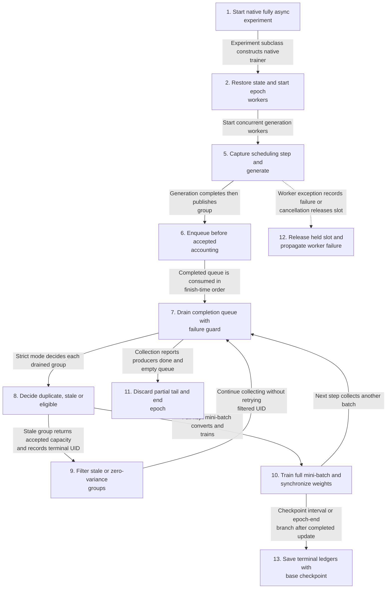
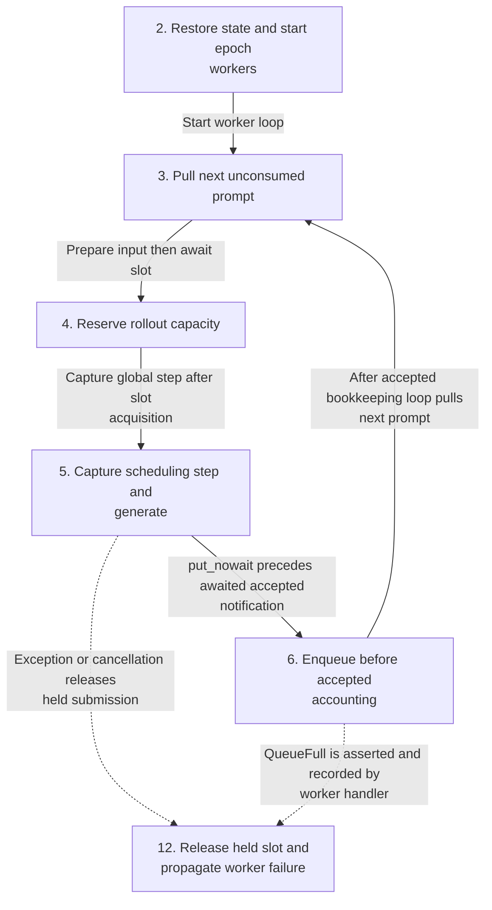
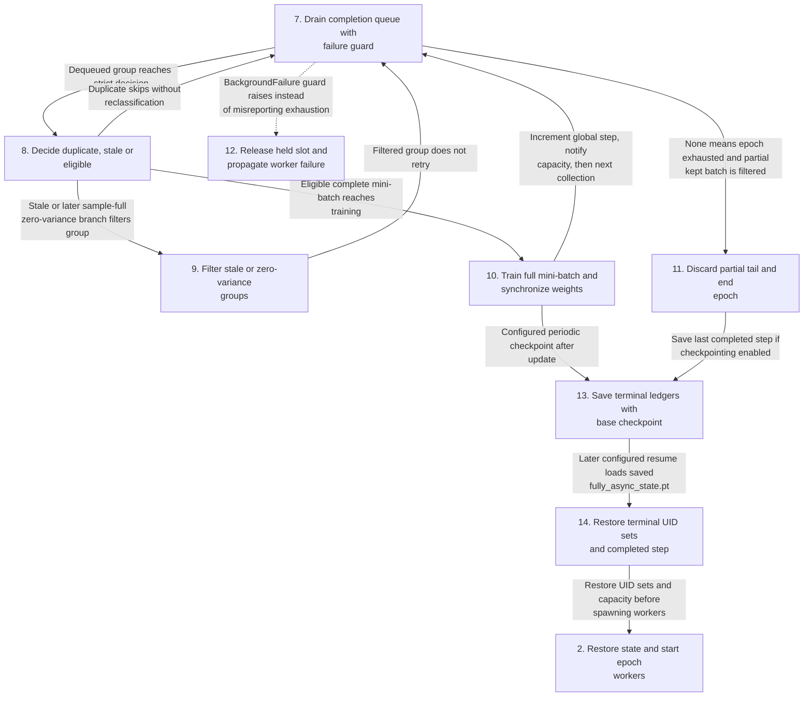
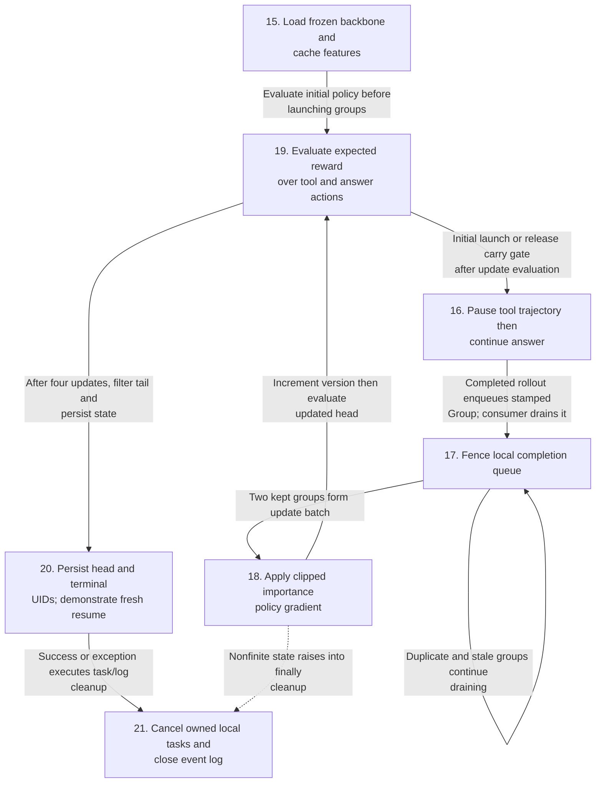
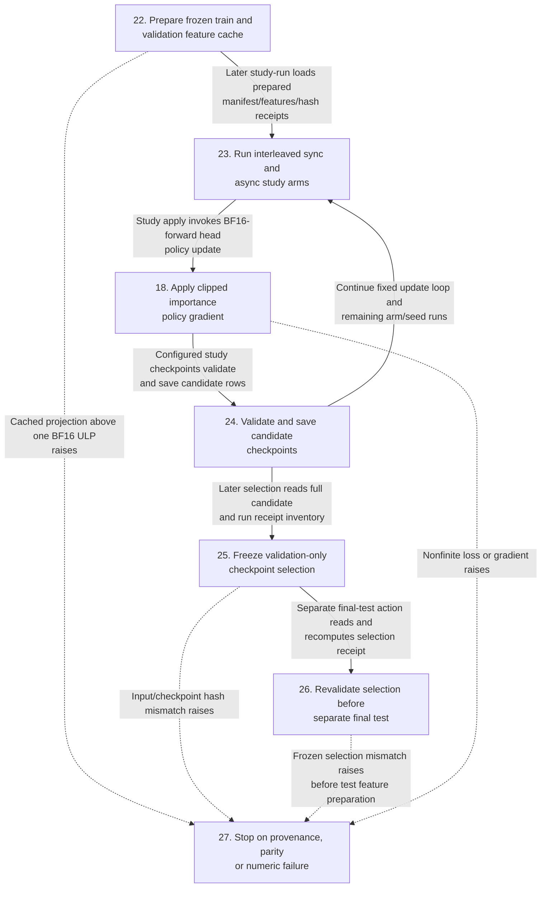
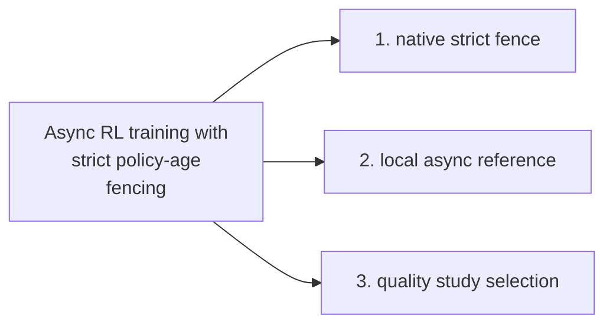
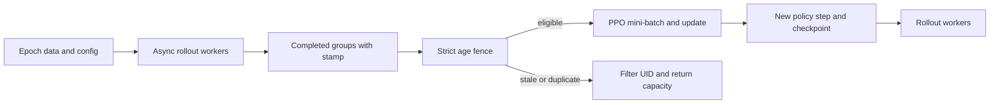
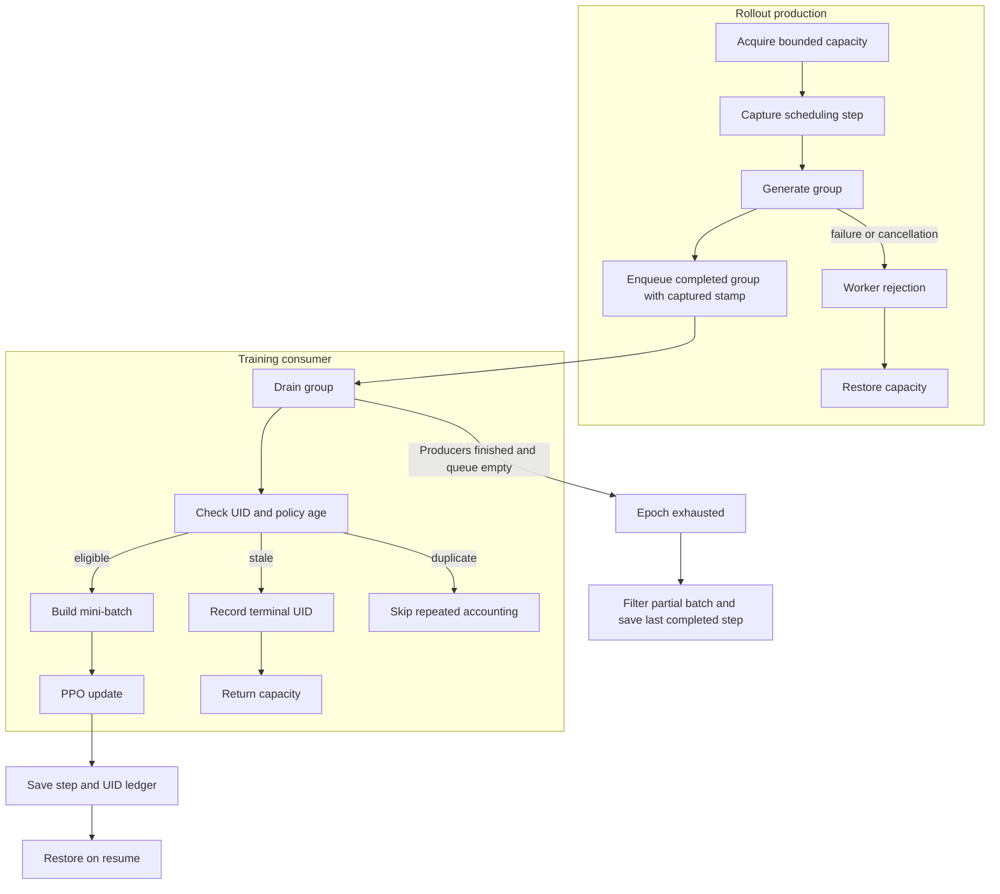

# Async RL training with strict policy-age fencing

This project adds opt-in strict policy-age fencing and a bounded pretrained-model reference run to the complete Apache-2.0 [SkyRL](https://github.com/NovaSky-AI/SkyRL) framework. It preserves the full upstream source and history at commit `b3046522ffb63738eed75a9f4853b92cc161b0ff`, all licenses and notices, distributed trainers, generators, and examples. The original [upstream README](README.upstream.md) is preserved verbatim.

The coursework source is [Asynchronous Agentic Reinforcement Learning](https://people.eecs.berkeley.edu/~kubitron/courses/cs262a-F25/projects/reports/project1008_paper_ver2_72488057446561351955.pdf), by Charlie Ruan, Hanchen Li, and Jiaxiang Yu for Berkeley CS262a Fall 2025. The [official fully async tutorial](https://docs.skyrl.ai/docs/tutorials/fully_async) describes the framework mechanism. This checkout is based on current official SkyRL, not a verified copy of the students' exact experimental branch. Their scaling-law and throughput experiments have not been reproduced.

## Contents

- [Architecture and execution guide](#architecture-and-execution-guide)
- [Implementation techniques](#implementation-techniques)
- [Resource-light quality repair](#resource-light-quality-repair)
- [Enable strict fencing in SkyRL](#enable-strict-fencing-in-skyrl)
- [Run the local pretrained reference](#run-the-local-pretrained-reference)
- [Verify changes](#verify-changes)
- [License](LICENSE)

## Architecture and execution guide

<!-- execution-flow:start -->
### Execution flow

Start with the primary path, then expand a detailed workflow. Select a numbered node to see its operation, implementation techniques, and source. Solid arrows show the named control, data, or lifecycle handoff; dotted arrows show error paths. Separate entry points are named in each workflow.

<a id="review-walkthrough"></a>

#### Walk through one concrete example

Run one supported matched-study training configuration on the bounded local reference fixture, then evaluate its held-out checkpoint.

**Trace.** [Prepare frozen train and validation feature cache](#flow-step-study-prepare) → [Run interleaved sync and async study arms](#flow-step-study-run) → [Apply clipped importance policy gradient](#flow-step-head-update) → [Validate and save candidate checkpoints](#flow-step-study-validation) → [Freeze validation-only checkpoint selection](#flow-step-study-select) → [Revalidate selection before separate final test](#flow-step-study-test).

**Result and boundary.** The study updates the training head, selects using validation evidence, and evaluates the chosen result on the test split; the strict native policy-age fencing flow is a distinct execution path.

<details>
<summary>Implementation decisions to explain</summary>

**Why use validation results for selection and reserve the test split for the selected run?** Selection on validation keeps the final test evidence separate from the choice; the tradeoff is that validation still guides the selected checkpoint.

[Frozen validation checkpoint selection](#technique-frozen-validation-checkpoint-selection) · [Teacher-forced expected-reward evaluation](#technique-teacher-forced-expectation-evaluation).

**Why evaluate cached logits for parity before running the study?** The parity gate checks that the cached frozen feature path agrees with its reference before training depends on it; this adds a prerequisite evaluation step.

[Cached-feature logit parity checks](#technique-cached-logit-parity-gate).

</details>

#### Primary execution flow

The native Ray entry drives bounded concurrent producers and one training consumer. Detailed workflows separate the local reference and study actions; neither is a native runtime continuation.



**Detailed workflows.** [Reserve, generate, enqueue and account](#flow-workflow-native-production) · [Drain, fence, train and resume](#flow-workflow-native-consumption-resume) · [Independent bounded pretrained local reference](#flow-workflow-local-reference) · [Separate study commands and frozen selection](#flow-workflow-matched-study).

<a id="flow-workflow-native-production"></a>

<details>
<summary>Reserve, generate, enqueue and account</summary>

Producer publication precedes accepted accounting. Accepted is distinct from later optimizer eligibility.



</details>

<a id="flow-workflow-native-consumption-resume"></a>

<details>
<summary>Drain, fence, train and resume</summary>

Finite strict/sample-full draining includes the completion/get race, terminal stale accounting, partial-tail discard and checkpoint ledgers.



</details>

<a id="flow-workflow-local-reference"></a>

<details>
<summary>Independent bounded pretrained local reference</summary>

scripts/verify_async_rl.py drive calls run and asyncio.run(train). This is a separate CUDA head-only mechanism demonstration, with no native trainer handoff.



</details>

<a id="flow-workflow-matched-study"></a>

<details>
<summary>Separate study commands and frozen selection</summary>

Preparation, training, selection and final test are separate CLI actions joined by persisted artifacts, not automatic function calls. Only explicit study-test accesses held-out prompts.



</details>

#### Steps, techniques, and source

These source traces cover the active scope below. They explain implementation behavior; benchmark results and their limits remain in the measurement sections.

<a id="flow-step-native-entry"></a>

##### 1. Start native fully async experiment

**Component.** main. The fully async example parses and validates configuration, initializes Ray and awaits its remote experiment. Its trainer subclass constructs FullyAsyncRayPPOTrainer; this entry has no handoff into the local reference.

This is an explicit entry, ordering boundary or terminal branch needed to explain the cited execution path.

**Source.** [`examples/train/fully_async/main_fully_async.py:46`](https://github.com/STEVVVU/async-rl-training/blob/main/examples/train/fully_async/main_fully_async.py#L46). [Back to execution flow](#execution-flow).

<a id="flow-step-native-epoch"></a>

##### 2. Restore state and start epoch workers

**Component.** train. train restores checkpoint ledgers and capacity when resuming, synchronizes inference weights, then starts generation tasks, a bounded completed-group queue and, for strict or sample-full mode, a completion watcher. A fresh fence is created for each epoch.

**Techniques at this step.** [Consumed and filtered UID checkpoint ledgers](#technique-uid-checkpoint-resume) · [Condition-based rollout capacity accounting](#technique-bounded-rollout-capacity).

**Source.** [`skyrl/train/fully_async_trainer.py:432`](https://github.com/STEVVVU/async-rl-training/blob/main/skyrl/train/fully_async_trainer.py#L432). [Back to execution flow](#execution-flow).

<a id="flow-step-native-prompt"></a>

##### 3. Pull next unconsumed prompt

**Component.** get_next_non_consumed_data. A locked dataloader skips terminal UIDs and stops at its effective mini-batch-divisible length. Each generator prepares input before acquiring a capacity slot.

**Techniques at this step.** [Consumed and filtered UID checkpoint ledgers](#technique-uid-checkpoint-resume).

**Source.** [`skyrl/train/fully_async_trainer.py:281`](https://github.com/STEVVVU/async-rl-training/blob/main/skyrl/train/fully_async_trainer.py#L281). [Back to execution flow](#execution-flow).

<a id="flow-step-native-capacity"></a>

##### 4. Reserve rollout capacity

**Component.** acquire_submission_slot. The condition waits until both running-worker and policy-step capacity permit submission. Reservation increments submitted and running; accepted means enqueued completion accounting, not optimizer admission.

**Techniques at this step.** [Condition-based rollout capacity accounting](#technique-bounded-rollout-capacity).

**Source.** [`skyrl/train/fully_async_trainer.py:190`](https://github.com/STEVVVU/async-rl-training/blob/main/skyrl/train/fully_async_trainer.py#L190). [Back to execution flow](#execution-flow).

<a id="flow-step-native-generate"></a>

##### 5. Capture scheduling step and generate

**Component.** _run_generate_for_a_group_loop. After acquiring a slot, the producer captures global_step and awaits generation. The captured step is a conservative oldest-policy bound for the whole group.

**Techniques at this step.** [Scheduling-step policy-age fencing](#technique-scheduling-step-age-fence).

**Source.** [`skyrl/train/fully_async_trainer.py:965`](https://github.com/STEVVVU/async-rl-training/blob/main/skyrl/train/fully_async_trainer.py#L965). [Back to execution flow](#execution-flow).

<a id="flow-step-native-enqueue"></a>

##### 6. Enqueue before accepted accounting

**Component.** _run_generate_for_a_group_loop. The producer put_nowait publishes a completed stamped group first. QueueFull raises an assertion; only after enqueue does it await on_rollout_accepted, which increments accepted, decrements running and notifies capacity waiters.

**Techniques at this step.** [Condition-based rollout capacity accounting](#technique-bounded-rollout-capacity).

**Source.** [`skyrl/train/fully_async_trainer.py:981`](https://github.com/STEVVVU/async-rl-training/blob/main/skyrl/train/fully_async_trainer.py#L981). [Back to execution flow](#execution-flow).

<a id="flow-step-native-drain"></a>

##### 7. Drain completion queue with failure guard

**Component.** _drain_next_group. Strict/sample-full mode checks background failure before queue state, returns buffered groups first, then detects all producers done. It races get against completion; if cancellation loses to a successful get it returns that popped item rather than discarding it. Non-strict non-sample-full mode uses guarded blocking get.

**Techniques at this step.** [Producer-completion queue draining](#technique-finite-epoch-drain) · [Background worker failure propagation](#technique-background-failure-propagation).

**Source.** [`skyrl/train/fully_async_trainer.py:766`](https://github.com/STEVVVU/async-rl-training/blob/main/skyrl/train/fully_async_trainer.py#L766). [Back to execution flow](#execution-flow).

<a id="flow-step-native-fence"></a>

##### 8. Decide duplicate, stale or eligible

**Component.** decide. The strict fence validates UID and versions, rejects duplicate UIDs without repeated accounting, and makes a first decision terminal for the epoch. Age is current scheduling step minus oldest captured step; values above max_age are stale.

**Techniques at this step.** [Scheduling-step policy-age fencing](#technique-scheduling-step-age-fence) · [Terminal UID duplicate suppression](#technique-uid-terminal-deduplication).

**Source.** [`skyrl/train/staleness.py:29`](https://github.com/STEVVVU/async-rl-training/blob/main/skyrl/train/staleness.py#L29). [Back to execution flow](#execution-flow).

<a id="flow-step-native-filter"></a>

##### 9. Filter stale or zero-variance groups

**Component.** _collect_generation_mini_batch. Stale groups, and zero-variance groups under sample_full_batch, reclassify already accepted accounting as filtered and add UID to consumed and filtered sets. They do not retry; duplicate groups skip this accounting.

**Techniques at this step.** [Scheduling-step policy-age fencing](#technique-scheduling-step-age-fence) · [Terminal UID duplicate suppression](#technique-uid-terminal-deduplication) · [Condition-based rollout capacity accounting](#technique-bounded-rollout-capacity).

**Source.** [`skyrl/train/fully_async_trainer.py:863`](https://github.com/STEVVVU/async-rl-training/blob/main/skyrl/train/fully_async_trainer.py#L863). [Back to execution flow](#execution-flow).

<a id="flow-step-native-update"></a>

##### 10. Train full mini-batch and synchronize weights

**Component.** _run_training. A full kept mini-batch converts to training input, computes values/log probabilities/reward and advantages, trains policy/critic, then marks trained UIDs consumed. Dispatch synchronizes sampler weights; the loop later increments global_step and notifies capacity.

**Techniques at this step.** [Consumed and filtered UID checkpoint ledgers](#technique-uid-checkpoint-resume).

**Source.** [`skyrl/train/fully_async_trainer.py:909`](https://github.com/STEVVVU/async-rl-training/blob/main/skyrl/train/fully_async_trainer.py#L909). [Back to execution flow](#execution-flow).

<a id="flow-step-native-exhaust"></a>

##### 11. Discard partial tail and end epoch

**Component.** train. When producers are done and the queue is empty, strict/sample-full collection reports exhaustion. The loop filters any partial kept mini-batch, optionally checkpoints the last completed step, then cancels/joins workers and validates empty queue and accounting before resetting epoch state.

**Techniques at this step.** [Producer-completion queue draining](#technique-finite-epoch-drain).

**Source.** [`skyrl/train/fully_async_trainer.py:550`](https://github.com/STEVVVU/async-rl-training/blob/main/skyrl/train/fully_async_trainer.py#L550). [Back to execution flow](#execution-flow).

<a id="flow-step-native-failure"></a>

##### 12. Release held slot and propagate worker failure

**Component.** _run_generate_for_a_group_loop. Cancellation releases a held slot with rejected accounting and exits. Other generation exceptions release the slot, record BackgroundFailure and re-raise; guarded consumers surface the failure, and train cancels and joins owned background tasks.

**Techniques at this step.** [Background worker failure propagation](#technique-background-failure-propagation).

**Source.** [`skyrl/train/fully_async_trainer.py:998`](https://github.com/STEVVVU/async-rl-training/blob/main/skyrl/train/fully_async_trainer.py#L998). [Back to execution flow](#execution-flow).

<a id="flow-step-native-checkpoint"></a>

##### 13. Save terminal ledgers with base checkpoint

**Component.** save_checkpoints. save_checkpoints snapshots consumed UIDs first, then filtered UIDs, calls base model/trainer checkpointing and writes fully_async_state.pt with epoch. This preserves filtered prompts as do-not-redraw without counting them as trained.

**Techniques at this step.** [Consumed and filtered UID checkpoint ledgers](#technique-uid-checkpoint-resume).

**Source.** [`skyrl/train/fully_async_trainer.py:1210`](https://github.com/STEVVVU/async-rl-training/blob/main/skyrl/train/fully_async_trainer.py#L1210). [Back to execution flow](#execution-flow).

<a id="flow-step-native-resume"></a>

##### 14. Restore terminal UID sets and completed step

**Component.** load_checkpoints. load_checkpoints requires fully_async_state.pt when a base checkpoint exists. Resume restores consumed/filtered sets even at step zero, verifies whole trained mini-batches, initializes capacity at completed step plus one, and uses saved epoch with older-checkpoint fallback.

**Techniques at this step.** [Consumed and filtered UID checkpoint ledgers](#technique-uid-checkpoint-resume).

**Source.** [`skyrl/train/fully_async_trainer.py:1237`](https://github.com/STEVVVU/async-rl-training/blob/main/skyrl/train/fully_async_trainer.py#L1237). [Back to execution flow](#execution-flow).

<a id="flow-step-local-load"></a>

##### 15. Load frozen backbone and cache features

**Component.** train. The independent local reference loads only cached trusted model assets on CUDA, freezes the backbone and unties the output head. It trains ten FP32 digit rows using SGD and caches the backbone final hidden vector for each prompt.

**Techniques at this step.** [Cached frozen features with head-only updates](#technique-cached-frozen-feature-head-training).

**Source.** [`examples/local_async/train.py:1163`](https://github.com/STEVVVU/async-rl-training/blob/main/examples/local_async/train.py#L1163). [Back to execution flow](#execution-flow).

<a id="flow-step-local-partial"></a>

##### 16. Pause tool trajectory then continue answer

**Component.** rollout. Each local group samples two tool actions, announces ready and waits on its own gate. After release it samples answer digits with the current head, records rewards and versions, then enqueues a group carrying its oldest version.

**Techniques at this step.** [Cooperative partial rollouts across policy updates](#technique-async-partial-rollouts).

**Source.** [`examples/local_async/train.py:1229`](https://github.com/STEVVVU/async-rl-training/blob/main/examples/local_async/train.py#L1229). [Back to execution flow](#execution-flow).

<a id="flow-step-local-admit"></a>

##### 17. Fence local completion queue

**Component.** train. The four-update reference drains two eligible groups per update through StalenessFence. Duplicate groups skip, stale groups become terminal and do not reach updates; carry gates deliberately span updates and a delayed straggler becomes stale.

**Techniques at this step.** [Cooperative partial rollouts across policy updates](#technique-async-partial-rollouts) · [Terminal UID filtering on resume](#technique-terminal-uid-resume).

**Source.** [`examples/local_async/train.py:1294`](https://github.com/STEVVVU/async-rl-training/blob/main/examples/local_async/train.py#L1294). [Back to execution flow](#execution-flow).

<a id="flow-step-head-update"></a>

##### 18. Apply clipped importance policy gradient

**Component.** apply_policy_update. For each action, recompute log probability from the current head and cached hidden vector, form the old-to-current importance ratio and clipped surrogate with reward minus 0.5. Reject nonfinite loss/gradient, clip gradient norm when enabled, step SGD, validate the master head and install converted output rows.

**Techniques at this step.** [Importance-corrected clipped policy gradient](#technique-clipped-importance-policy-gradient) · [Gradient-norm clipping](#technique-gradient-norm-clipping).

**Source.** [`examples/local_async/train.py:303`](https://github.com/STEVVVU/async-rl-training/blob/main/examples/local_async/train.py#L303). [Back to execution flow](#execution-flow).

<a id="flow-step-local-evaluate"></a>

##### 19. Evaluate expected reward over tool and answer actions

**Component.** evaluate. The local evaluate function sums answer probabilities weighted by tool probabilities over held-out arithmetic prompts. This teacher-forced expectation produces a curve without requiring sampled wording or a reward improvement.

**Techniques at this step.** [Teacher-forced expected-reward evaluation](#technique-teacher-forced-expectation-evaluation).

**Source.** [`examples/local_async/train.py:1265`](https://github.com/STEVVVU/async-rl-training/blob/main/examples/local_async/train.py#L1265). [Back to execution flow](#execution-flow).

<a id="flow-step-local-save-resume"></a>

##### 20. Persist head and terminal UIDs; demonstrate fresh resume

**Component.** train. The reference marks remaining queued groups as epoch-tail filtered, saves JSON terminal/trained UID state and safetensors head weights, reloads them, and filters candidate UIDs against the terminal set. Only resumed-fresh is launched; assertions check restored head equality and eligibility.

**Techniques at this step.** [Terminal UID filtering on resume](#technique-terminal-uid-resume).

**Source.** [`examples/local_async/train.py:1320`](https://github.com/STEVVVU/async-rl-training/blob/main/examples/local_async/train.py#L1320). [Back to execution flow](#execution-flow).

<a id="flow-step-local-cleanup"></a>

##### 21. Cancel owned local tasks and close event log

**Component.** train. The local reference finally cancels unfinished rollout tasks, gathers them and closes the events stream. Checkpoint/metrics assertions establish reference mechanics only; native distributed execution is explicitly recorded as not executed.

This is an explicit entry, ordering boundary or terminal branch needed to explain the cited execution path.

**Source.** [`examples/local_async/train.py:1385`](https://github.com/STEVVVU/async-rl-training/blob/main/examples/local_async/train.py#L1385). [Back to execution flow](#execution-flow).

<a id="flow-step-study-prepare"></a>

##### 22. Prepare frozen train and validation feature cache

**Component.** prepare_study. prepare_study builds only train/validation prompts, checks single-token digit IDs and compares cached BF16 projections with full-model logits for both two and ten rows. More than one BF16 ULP fails preparation; features, manifest and source/model/input hashes are persisted.

**Techniques at this step.** [Cached frozen features with head-only updates](#technique-cached-frozen-feature-head-training) · [Cached-feature logit parity checks](#technique-cached-logit-parity-gate).

**Source.** [`examples/local_async/train.py:348`](https://github.com/STEVVVU/async-rl-training/blob/main/examples/local_async/train.py#L348). [Back to execution flow](#execution-flow).

<a id="flow-step-study-run"></a>

##### 23. Run interleaved sync and async study arms

**Component.** run_study. run_study loads prepared inputs and executes the fixed arm/seed order. Sync groups finish before updates; async arms start the next partial groups before the current update and release their continuations afterward. Each admitted batch has two eligible groups; final carries become tail terminals.

**Techniques at this step.** [Cooperative partial rollouts across policy updates](#technique-async-partial-rollouts) · [Importance-corrected clipped policy gradient](#technique-clipped-importance-policy-gradient) · [Gradient-norm clipping](#technique-gradient-norm-clipping).

**Source.** [`examples/local_async/train.py:511`](https://github.com/STEVVVU/async-rl-training/blob/main/examples/local_async/train.py#L511). [Back to execution flow](#execution-flow).

<a id="flow-step-study-validation"></a>

##### 24. Validate and save candidate checkpoints

**Component.** run_study. At configured checkpoints the study checks cached logit parity, evaluates expected validation reward, saves FP32 master and installed BF16 head rows, and reloads them exactly. Metrics and receipts bind candidate files, inputs, model, source, configuration and run order.

**Techniques at this step.** [Cached-feature logit parity checks](#technique-cached-logit-parity-gate) · [Teacher-forced expected-reward evaluation](#technique-teacher-forced-expectation-evaluation).

**Source.** [`examples/local_async/train.py:746`](https://github.com/STEVVVU/async-rl-training/blob/main/examples/local_async/train.py#L746). [Back to execution flow](#execution-flow).

<a id="flow-step-study-select"></a>

##### 25. Freeze validation-only checkpoint selection

**Component.** _build_selection. _build_selection verifies prepared data, all run receipts and candidate tensors/hashes, then chooses maximum validation expected reward with earlier step as tie-break. select_study writes a new selection receipt and refuses to overwrite one; test prompts are not accessed.

**Techniques at this step.** [Frozen validation checkpoint selection](#technique-frozen-validation-checkpoint-selection).

**Source.** [`examples/local_async/train.py:871`](https://github.com/STEVVVU/async-rl-training/blob/main/examples/local_async/train.py#L871). [Back to execution flow](#execution-flow).

<a id="flow-step-study-test"></a>

##### 26. Revalidate selection before separate final test

**Component.** test_study. A separate test_study action refuses overwrite, recomputes frozen selection and verifies it before constructing test features. It checks cached logits for initial and selected heads, evaluates expected reward and writes a final receipt; quality is reported rather than asserted.

**Techniques at this step.** [Frozen validation checkpoint selection](#technique-frozen-validation-checkpoint-selection) · [Teacher-forced expected-reward evaluation](#technique-teacher-forced-expectation-evaluation) · [Cached-feature logit parity checks](#technique-cached-logit-parity-gate).

**Source.** [`examples/local_async/train.py:1021`](https://github.com/STEVVVU/async-rl-training/blob/main/examples/local_async/train.py#L1021). [Back to execution flow](#execution-flow).

<a id="flow-step-study-invalid"></a>

##### 27. Stop on provenance, parity or numeric failure

**Component.** _build_selection. Study input/receipt mismatch, invalid checkpoint tensors, BF16 parity violations and nonfinite policy state raise errors. Selection and final-test receipts are created exclusively; no fallback selects a different source or retries invalid data.

**Techniques at this step.** [Frozen validation checkpoint selection](#technique-frozen-validation-checkpoint-selection).

**Source.** [`examples/local_async/train.py:876`](https://github.com/STEVVVU/async-rl-training/blob/main/examples/local_async/train.py#L876). [Back to execution flow](#execution-flow).

<details>
<summary>Scope and subsystem coverage</summary>

Active opt-in native SkyRL fully asynchronous PPO trainer and separate bounded examples/local_async cached-feature reference, including strict fencing and frozen-head quality-study drivers; excludes inactive upstream examples and unrelated preserved apps.

- **native strict fence.** Native producer, consumer, failure, finite drain and persisted UID restoration paths. [Step 2](#flow-step-native-epoch), [Step 3](#flow-step-native-prompt), [Step 4](#flow-step-native-capacity), [Step 5](#flow-step-native-generate), [Step 6](#flow-step-native-enqueue), [Step 7](#flow-step-native-drain), [Step 8](#flow-step-native-fence), [Step 9](#flow-step-native-filter), [Step 10](#flow-step-native-update), [Step 11](#flow-step-native-exhaust), [Step 12](#flow-step-native-failure), [Step 13](#flow-step-native-checkpoint), [Step 14](#flow-step-native-resume).
- **local async reference.** Separate frozen-backbone local action sampling, partial continuations, optimizer and terminal resume demonstration. [Step 15](#flow-step-local-load), [Step 16](#flow-step-local-partial), [Step 17](#flow-step-local-admit), [Step 18](#flow-step-head-update), [Step 20](#flow-step-local-save-resume), [Step 22](#flow-step-study-prepare), [Step 23](#flow-step-study-run).
- **quality study selection.** Independent prepared-feature study with BF16 checks, validation-only selection and separate held-out expectation evaluation. [Step 18](#flow-step-head-update), [Step 19](#flow-step-local-evaluate), [Step 22](#flow-step-study-prepare), [Step 23](#flow-step-study-run), [Step 24](#flow-step-study-validation), [Step 25](#flow-step-study-select), [Step 26](#flow-step-study-test), [Step 27](#flow-step-study-invalid).

Outside this flow audit:

- `scripts/verify_async_rl.py`. Real-product verification driver; documents launch, evidence, and cleanup rather than training algorithm paths.
- `tests/local_async/test_staleness.py`. Regression tests validate fence behavior but are not implementation paths.
- `tests/local_async/test_checkpoint_boundary.py`. Regression tests validate checkpoint boundaries but are not implementation paths.

</details>

<!-- execution-flow:end -->

<details>
<summary>Subsystem technique index</summary>

### Subsystem map

Select a subsystem in the diagram to open its techniques, tradeoffs, and code references. The numbered links provide the same navigation. This map groups components; the execution diagrams show their runtime flow.



1. [native strict fence](#subsystem-native-strict-fence)
2. [local async reference](#subsystem-local-async-reference)
3. [quality study selection](#subsystem-quality-study-selection)

This repository retains SkyRL and adds opt-in strict age checks to the fully asynchronous PPO trainer, plus a separate bounded local reference. The native trainer uses distributed rollout and training backends; the local reference reuses the fence with a small frozen Qwen model. It does not validate native distributed execution. A [rollout group](#rollout-group) carries a UID and scheduling stamp through the [policy age](#policy-age) check.

The top-level flow separates producers from the training consumer. Eligible groups reach PPO; stale and duplicate groups do not.

</details>

<details>
<summary>Expand flow diagram 1</summary>



</details>

The inner lifecycle shows capacity and checkpoint boundaries. Stale UIDs become terminal for the epoch; exhaustion filters a partial final mini-batch.

<details>
<summary>Expand flow diagram 2</summary>



</details>

| Subsystem | Responsibility and owned state | Source |
| --- | --- | --- |
| Fence | Validates UIDs and step values, then classifies a group as keep, stale, or duplicate. | [`staleness.py`](skyrl/train/staleness.py) |
| Staleness manager | Tracks submitted, accepted, filtered, and running groups and gates producer capacity. | [`fully_async_trainer.py`](skyrl/train/fully_async_trainer.py) |
| UID ledger | Tracks consumed and filtered data across epoch reset and checkpoint reload. | [`fully_async_trainer.py`](skyrl/train/fully_async_trainer.py) |
| Native trainer | Starts per-epoch workers, drains groups, builds batches, updates policy, and saves checkpoints. | [`fully_async_trainer.py`](skyrl/train/fully_async_trainer.py) |
| Local reference | Drives the cached model and checks retained bounded-run evidence. | [`train.py`](examples/local_async/train.py), [`verify_async_rl.py`](scripts/verify_async_rl.py) |
| Regression checks | Cover boundaries, duplicates, exhaustion, capacity, and checkpoint behavior without native imports. | [`test_staleness.py`](tests/local_async/test_staleness.py), [`test_checkpoint_boundary.py`](tests/local_async/test_checkpoint_boundary.py) |

Execution journey:

1. SkyRL creates per-epoch dataloader state, bounded producer capacity, and rollout workers.
2. A worker acquires capacity and captures the current scheduling step before generation. It enqueues the completed [rollout group](#rollout-group) with that stamp.
3. The consumer drains the group and checks its UID and [policy age](#policy-age) against the current update step.
4. Strict mode trains eligible groups. A stale group records a [terminal UID](#terminal-uid) and returns capacity; duplicate delivery does not repeat these effects.
5. The trainer builds PPO input and updates the policy. At exhaustion, strict mode filters an incomplete mini-batch and may complete fewer updates.
6. Checkpoints save the last completed step and UID ledgers. Resume restores filtered UIDs, including after zero updates. Worker failures propagate instead of leaving the consumer waiting indefinitely.

| Choice | Current behavior and rationale inferred from code | Alternative and cost to reconsider |
| --- | --- | --- |
| Make strict mode opt-in | `strict_staleness=false` keeps warning-only admission for existing runs. | Changing the default alters training data and update counts. |
| Stamp the scheduling step | Conservatively bounds oldest policy age through a group's generation. | Per-token stamps are more precise but add metadata and group-loss complexity. |
| Make stale UIDs terminal per epoch | Prevents regeneration and makes duplicate deliveries idempotent. | Retrying under a new UID may repeat stale work and changes data accounting. |
| Return capacity on terminal outcomes | Keeps producer accounting bounded as groups finish, fail, or are filtered. | Delayed release can stall producers; loose accounting can exceed configured capacity. |
| Filter partial final batches | Preserves configured batch semantics but can reduce updates at exhaustion. | Training partial batches uses more samples but changes optimizer batch behavior. |
| Keep local reference separate | Demonstrates mechanics on one GPU without implying native distributed validation. | Combining its result with native evidence would overstate backend coverage. |

These are implementation tradeoffs, not recorded historical intent. The local run does not establish native throughput or general model quality.

<a id="rollout-group"></a>

<details><summary>What is a rollout group?</summary>

A rollout group holds generated trajectories for one training UID. The local reference samples two trajectories per group.

</details>

<a id="policy-age"></a>

<details><summary>What is policy age?</summary>

Policy age is the difference between the current update step and a group's scheduling stamp. At a maximum age of one, age one is accepted and older groups are stale.

</details>

<a id="terminal-uid"></a>

<details><summary>What is a terminal UID?</summary>

A terminal UID is data that this epoch must not generate or consume again. Strict stale filtering records it for duplicate handling and checkpoint resume.

</details>

<a id="capacity-accounting"></a>

<details><summary>What is capacity accounting?</summary>

Capacity accounting tracks submitted, accepted, filtered, and running groups against the producer limit. The manager checks their balance at epoch end.

</details>

<a id="partial-mini-batch"></a>

<details><summary>What is a partial mini-batch?</summary>

A partial mini-batch has fewer eligible groups than configured when generation ends. Strict mode filters this tail, so an epoch may train fewer steps.

</details>

## Implementation techniques

This covers active native strict fencing and the bounded local cached-feature reference. Tradeoff rationale is inferred from current code.

<details>
<summary>Full technique index</summary>

| Subsystem | Techniques | Sources |
|---|---|---|
| Native strict fence | [Age fence](#technique-scheduling-step-age-fence), [UID suppression](#technique-uid-terminal-deduplication), [capacity](#technique-bounded-rollout-capacity), [drain](#technique-finite-epoch-drain), [failure propagation](#technique-background-failure-propagation), [checkpoint resume](#technique-uid-checkpoint-resume) | [staleness.py](skyrl/train/staleness.py), [fully_async_trainer.py](skyrl/train/fully_async_trainer.py) |
| Local reference | [Cached head training](#technique-cached-frozen-feature-head-training), [partial rollouts](#technique-async-partial-rollouts), [clipped update](#technique-clipped-importance-policy-gradient), [UID resume](#technique-terminal-uid-resume), [validation selection](#technique-frozen-validation-checkpoint-selection), [expected reward](#technique-teacher-forced-expectation-evaluation), [gradient clipping](#technique-gradient-norm-clipping), [logit parity](#technique-cached-logit-parity-gate) | [train.py](examples/local_async/train.py) |

</details>

<a id="subsystem-native-strict-fence"></a>

### 1. native strict fence

[Back to the subsystem map](#architecture-and-execution-guide).

**Code.** [`skyrl/train/staleness.py`](skyrl/train/staleness.py), [`skyrl/train/fully_async_trainer.py`](skyrl/train/fully_async_trainer.py).

**Techniques.** [Scheduling-step policy-age fencing](#technique-scheduling-step-age-fence), [Terminal UID duplicate suppression](#technique-uid-terminal-deduplication), [Condition-based rollout capacity accounting](#technique-bounded-rollout-capacity), [Producer-completion queue draining](#technique-finite-epoch-drain), [Background worker failure propagation](#technique-background-failure-propagation), [Consumed and filtered UID checkpoint ledgers](#technique-uid-checkpoint-resume).

**Related concepts.** [terminal UID](#terminal-uid), [capacity accounting](#capacity-accounting).

<a id="technique-scheduling-step-age-fence"></a>

<details>
<summary>Scheduling-step policy-age fencing</summary>

**Mechanism.** Stamp each group at scheduling; admit only when current minus stamp is within max age.

**Example.** illustrative inputs, not a measurement: With max age 1, a group stamped at version 4 reaches the consumer at version 5 and is kept; if it arrives at version 6, it is stale.

**Why here.** Adds an individual age bound to the aggregate producer capacity rule.

**Tradeoffs.** Group-level stamps are conservative; strict behavior is opt-in.

**Code and ownership.** [skyrl/train/staleness.py#L26](skyrl/train/staleness.py#L26) (extension except inherited SkyRL capacity and drain/failure paths).


**Used in.** [native strict fence](#subsystem-native-strict-fence). [Back to the subsystem map](#architecture-and-execution-guide).

</details>

<a id="technique-uid-terminal-deduplication"></a>

<details>
<summary>Terminal UID duplicate suppression</summary>

**Mechanism.** A UID is recorded on first decision; later queue deliveries return duplicate before accounting.

**Example.** illustrative inputs, not a measurement: UID `g-7` is first classified stale and recorded; a second queued copy of `g-7` is classified duplicate, so it cannot be counted again.

**Why here.** Makes terminal stale handling idempotent per epoch.

**Tradeoffs.** The fence is epoch-local; checkpoint code persists the relevant UIDs.

**Code and ownership.** [skyrl/train/staleness.py#L26](skyrl/train/staleness.py#L26) (extension except inherited SkyRL capacity and drain/failure paths).


**Used in.** [native strict fence](#subsystem-native-strict-fence). [Back to the subsystem map](#architecture-and-execution-guide).

</details>

<a id="technique-bounded-rollout-capacity"></a>

<details>
<summary>Condition-based capacity accounting</summary>

**Mechanism.** Available submissions are the minimum of concurrency room and staleness budget after accepted and running work.

**Example.** illustrative inputs, not a measurement: With batch size 2, current step 3, max age 1, limit 5 workers, 4 accepted groups, and 1 running group, the formula gives capacity `min(5-1, (1+3)*2-(4+1)) = 3`.

**Why here.** Bounds outstanding generation while releasing slots on outcomes.

**Tradeoffs.** Aggregate steady-state capacity does not guarantee each group age.

**Code and ownership.** [skyrl/train/fully_async_trainer.py#L182](skyrl/train/fully_async_trainer.py#L182) (extension except inherited SkyRL capacity and drain/failure paths).


**Used in.** [native strict fence](#subsystem-native-strict-fence). [Back to the subsystem map](#architecture-and-execution-guide).

</details>

<a id="technique-finite-epoch-drain"></a>

<details>
<summary>Producer-completion queue drain</summary>

**Mechanism.** Race queue retrieval against all-producers-done; exhaustion occurs only after the queue is empty.

**Example.** illustrative queue state, not a measurement: If every producer has stopped but one completed group remains buffered, the drain returns that group first; only a later empty-queue check reports exhaustion.

**Why here.** Allows exhaustion after filtering without indefinite blocking.

**Tradeoffs.** Dropping the incomplete tail can reduce updates.

**Code and ownership.** [skyrl/train/fully_async_trainer.py#L765](skyrl/train/fully_async_trainer.py#L765) (extension except inherited SkyRL capacity and drain/failure paths).


**Used in.** [native strict fence](#subsystem-native-strict-fence). [Back to the subsystem map](#architecture-and-execution-guide).

</details>

<a id="technique-background-failure-propagation"></a>

<details>
<summary>Background failure propagation</summary>

**Mechanism.** Check recorded worker failures while waiting so consumer does not hang on a dead producer.

**Example.** illustrative failure path: If a rollout worker records an exception while the consumer waits for a group, the wait raises that exception instead of treating producer completion as a normal empty epoch.

**Why here.** Surfaces producer exceptions at the consumer boundary.

**Tradeoffs.** Failure aborts this path; it does not retry generation.

**Code and ownership.** [skyrl/train/fully_async_trainer.py#L765](skyrl/train/fully_async_trainer.py#L765) (extension except inherited SkyRL capacity and drain/failure paths).


**Used in.** [native strict fence](#subsystem-native-strict-fence). [Back to the subsystem map](#architecture-and-execution-guide).

</details>

<a id="technique-uid-checkpoint-resume"></a>

<details>
<summary>Consumed and filtered UID checkpoint resume</summary>

**Mechanism.** Persist consumed and filtered UIDs with epoch and restore those ledgers on reload.

**Example.** illustrative checkpoint state: A checkpoint records consumed UIDs `{u1, u2}` and filtered UID `{u2}`; on resume both are skipped from redraw, while the filtered set distinguishes `u2` from trained data.

**Why here.** Async completion order makes step count insufficient to identify data progress.

**Tradeoffs.** Adds checkpoint state and compatibility handling.

**Code and ownership.** [skyrl/train/fully_async_trainer.py#L1210](skyrl/train/fully_async_trainer.py#L1210) (extension except inherited SkyRL capacity and drain/failure paths).


**Used in.** [native strict fence](#subsystem-native-strict-fence). [Back to the subsystem map](#architecture-and-execution-guide).

</details>

<a id="subsystem-local-async-reference"></a>

### 2. local async reference

[Back to the subsystem map](#architecture-and-execution-guide).

**Code.** [`examples/local_async/train.py`](examples/local_async/train.py), [`skyrl/train/staleness.py`](skyrl/train/staleness.py).

**Techniques.** [Cached frozen features with head-only updates](#technique-cached-frozen-feature-head-training), [Cooperative partial rollouts across policy updates](#technique-async-partial-rollouts), [Importance-corrected clipped policy gradient](#technique-clipped-importance-policy-gradient), [Terminal UID filtering on resume](#technique-terminal-uid-resume).

**Related concepts.** [terminal UID](#terminal-uid).

<a id="technique-cached-frozen-feature-head-training"></a>

<details>
<summary>Cached frozen features with head-only updates</summary>

**Mechanism.** Freeze backbone, cache prompt hidden states, update a float32 subset of output rows.

**Example.** illustrative prompt: For `Compute (6+7) modulo 10. Choose tool 0 for sum, 1 for difference. Tool:`, the frozen backbone’s final prompt state is cached and reused while the selected digit output rows are trained.

**Why here.** The local reference isolates a small policy while reusing fixed-prompt backbone work.

**Tradeoffs.** Cache validity depends on frozen backbone and prompt keys; not full-model training.

**Code and ownership.** [examples/local_async/train.py#L1163](examples/local_async/train.py#L1163) (extension except inherited SkyRL capacity and drain/failure paths).


**Used in.** [local async reference](#subsystem-local-async-reference). [Back to the subsystem map](#architecture-and-execution-guide).

</details>

<a id="technique-async-partial-rollouts"></a>

<details>
<summary>Cooperative partial rollouts across policy updates</summary>

**Mechanism.** A task samples tool action, pauses, then samples answer after policy updates and queues the group.

**Example.** illustrative task timeline: UID `g-2` samples its two tool actions at policy version 0, waits at the gate while an update advances the policy, then samples its answer actions and enqueues the completed group.

**Why here.** Makes policy lag and stragglers visible on one local event loop.

**Tradeoffs.** Single-process cooperative tasks do not establish distributed throughput.

**Code and ownership.** [examples/local_async/train.py#L1230](examples/local_async/train.py#L1230) (extension except inherited SkyRL capacity and drain/failure paths).


**Used in.** [local async reference](#subsystem-local-async-reference). [Back to the subsystem map](#architecture-and-execution-guide).

</details>

<a id="technique-clipped-importance-policy-gradient"></a>

<details>
<summary>Importance-corrected clipped policy gradient</summary>

**Mechanism.** Compute current/stored probability ratio and optimize clipped reward-advantage surrogate.

**Example.** illustrative action: For one sampled action, subtract its stored log probability from the current log probability, exponentiate to form the ratio, and use the reward advantage with the ratio clipped to `[0.8, 1.2]` in the surrogate.

**Why here.** Stored log probabilities support correction for mixed-policy actions.

**Tradeoffs.** Clipping can bias the surrogate and is not full native PPO parity.

**Code and ownership.** [examples/local_async/train.py#L303](examples/local_async/train.py#L303) (extension except inherited SkyRL capacity and drain/failure paths).


**Used in.** [local async reference](#subsystem-local-async-reference). [Back to the subsystem map](#architecture-and-execution-guide).

</details>

<a id="technique-terminal-uid-resume"></a>

<details>
<summary>Terminal UID filtering on resume</summary>

**Mechanism.** Reload terminal UIDs, skip them, and verify exact head weights from safetensors.

**Example.** illustrative resume state: After loading terminal UID `g-2` and the saved head tensor, resume skips `g-2`; a new UID can generate a fresh group using the restored head.

**Why here.** Demonstrates state continuity with stateless SGD.

**Tradeoffs.** This compact demonstration is not a general crash-safe format.

**Code and ownership.** [examples/local_async/train.py#L1329](examples/local_async/train.py#L1329) (extension except inherited SkyRL capacity and drain/failure paths).


**Used in.** [local async reference](#subsystem-local-async-reference). [Back to the subsystem map](#architecture-and-execution-guide).

</details>

<a id="subsystem-quality-study-selection"></a>

### 3. quality study selection

[Back to the subsystem map](#architecture-and-execution-guide).

**Code.** [`examples/local_async/train.py`](examples/local_async/train.py).

**Techniques.** [Frozen validation checkpoint selection](#technique-frozen-validation-checkpoint-selection), [Teacher-forced expected-reward evaluation](#technique-teacher-forced-expectation-evaluation), [Gradient-norm clipping](#technique-gradient-norm-clipping), [Cached-feature logit parity checks](#technique-cached-logit-parity-gate).

<a id="technique-frozen-validation-checkpoint-selection"></a>

<details>
<summary>Frozen validation checkpoint selection</summary>

**Mechanism.** Select the validation-best predeclared checkpoint, tie-breaking toward earlier step before test.

**Example.** illustrative candidate values, not study results: If declared steps 32 and 128 tie on validation reward, the selection key prefers step 32; the held-out test is evaluated only after that choice.

**Why here.** Separates model selection from held-out evaluation.

**Tradeoffs.** A small validation set can be overfit.

**Code and ownership.** [examples/local_async/train.py#L871](examples/local_async/train.py#L871) (extension except inherited SkyRL capacity and drain/failure paths).


**Used in.** [quality study selection](#subsystem-quality-study-selection). [Back to the subsystem map](#architecture-and-execution-guide).

</details>

<a id="technique-teacher-forced-expectation-evaluation"></a>

<details>
<summary>Teacher-forced expected-reward evaluation</summary>

**Mechanism.** Sum reward over tool choices weighted by tool probability and conditional answer probabilities.

**Example.** illustrative prompt: For operands 6 and 7, let `p0`/`p1` be the probabilities of sum/difference and `q0(3)`/`q1(3)` the conditional probabilities of answering 3; expected reward is `p0*(q0(3)+0.25) + p1*q1(3)`.

**Why here.** The tiny discrete action space supports direct expectation calculation.

**Tradeoffs.** Teacher-forced expectations are not sampled free-running generation.

**Code and ownership.** [examples/local_async/train.py#L1266](examples/local_async/train.py#L1266) (extension except inherited SkyRL capacity and drain/failure paths).


**Used in.** [quality study selection](#subsystem-quality-study-selection). [Back to the subsystem map](#architecture-and-execution-guide).

</details>

<a id="technique-gradient-norm-clipping"></a>

<details>
<summary>Gradient-norm clipping</summary>

**Mechanism.** Check finite gradients, clip their norm, step SGD, then verify finite head values.

**Example.** illustrative gradient state: If the computed gradient is finite but its norm exceeds `max_grad_norm`, clip it before the SGD step, then reject the update if the resulting head contains a nonfinite value.

**Why here.** Constrains oversized updates while rejecting nonfinite gradients.

**Tradeoffs.** Clipping changes updates above threshold and does not ensure reward gains.

**Code and ownership.** [examples/local_async/train.py#L326](examples/local_async/train.py#L326) (extension except inherited SkyRL capacity and drain/failure paths).


**Used in.** [quality study selection](#subsystem-quality-study-selection). [Back to the subsystem map](#architecture-and-execution-guide).

</details>

<a id="technique-cached-logit-parity-gate"></a>

<details>
<summary>Cached-feature logit parity checks</summary>

**Mechanism.** Compare cached-feature and fresh-forward BF16 logits under the declared one-ULP gate.

**Example.** illustrative consistency check: For a prompt, compare fresh-forward logits with logits projected from its cached feature for the selected digit rows; reject nonfinite values or a maximum discrepancy above the one-BF16-ULP gate.

**Why here.** Checks cache equivalence for the training path.

**Tradeoffs.** Parity does not establish quality or distributed behavior.

**Code and ownership.** [examples/local_async/train.py#L263](examples/local_async/train.py#L263) (extension except inherited SkyRL capacity and drain/failure paths).


**Used in.** [quality study selection](#subsystem-quality-study-selection). [Back to the subsystem map](#architecture-and-execution-guide).

</details>

## Resource-light quality repair

On a separate [fresh wider-operand holdout](docs/fresh-head-holdout-20261024.md), the five frozen, validation-selected clipped heads averaged **49.91% expected correct-answer probability versus 40.20%** for the initial head across 256 new arithmetic pairs. Every seed improved. The evaluation took 61.50 seconds and 1.42 GiB peak Torch CUDA allocation. This is a constrained tool-and-digit policy expectation, not general model accuracy or 1,280 independent questions.

The [24 October head-quality comparison](docs/head-quality-20261024.md) fixes oversized local head updates with native gradient-norm clipping. Across five seeds, validation-selected policies increased mean expected correct-answer probability from **56.29% to 64.33%** and expected reward from **0.758882 to 0.886297** on ten reused held-out arithmetic pairs. These are constrained-policy expectations, not general LLM accuracy or fifty independent questions. The original negative sync/async study remains below.

The complete ten-run CPU sweep used one thread, **7.27 seconds** before receipt writing and **611 MiB** peak parent memory. It reused frozen pretrained features without loading the model. A separate model/logit evaluation took 16.77 seconds and about 1.43 GiB of Torch CUDA allocation. The report retains all seeds, 30 checkpoint hashes, model-logit checks, resources and reproducible commands. No distributed throughput or speedup is claimed.

## Enable strict fencing in SkyRL

Use the existing fully async entrypoint and normal model, data, and cluster configuration. Add `trainer.fully_async.strict_staleness=true`. For example, adapt the retained `examples/train/fully_async/fully_async_run_gsm8k.sh` and keep its backend settings.

`max_staleness_steps` normally limits aggregate producer capacity. A long-running group can exceed that age. Strict mode checks each completed group's scheduling step against the consumer step before admitting it to a mini-batch. The scheduling stamp conservatively bounds its oldest token policy, including continuations after in-flight updates. Groups exactly at the age limit remain eligible.

A stale group is terminal for its UID for the current epoch. Its capacity is returned and the existing filtered-UID checkpoint ledger prevents regeneration on resume. A duplicate queue delivery does not repeat those effects. An exhausted epoch filters its partial final mini-batch and can train fewer steps. Exhaustion and final checkpoints record the last completed update, including zero, while ordinary post-update checkpoints retain their normal step number. Zero-update checkpoint reload also restores filtered UIDs. The default remains `strict_staleness=false`, preserving warning-only admission.

## Run the local pretrained reference

This separate backend runs on the observed Windows Python 3.11 environment. It uses real cached [Qwen3-0.6B](https://huggingface.co/Qwen/Qwen3-0.6B/blob/c1899de289a04d12100db370d81485cdf75e47ca/README.md) safetensors at revision `c1899de289a04d12100db370d81485cdf75e47ca`, licensed Apache-2.0. It requires CUDA and the versions recorded in [requirements.txt](examples/local_async/requirements.txt). It never downloads a model, enables remote Python, or installs into the shared ML environment.

```powershell
$uv = 'C:/Users/steve/.codex/tools/uv-0.13.4/uv-0.13.4.data/scripts/uv.exe'
$ml = 'C:/Users/steve/.codex/tools/coursework-ml/Scripts/python.exe'
& $uv run --isolated --no-project --python $ml -- cmd.exe /d /c $ml scripts/verify_async_rl.py doctor
& $uv run --isolated --no-project --python $ml -- cmd.exe /d /c $ml scripts/verify_async_rl.py drive --output .evidence/my-new-run
& $uv run --isolated --no-project --python $ml -- cmd.exe /d /c $ml scripts/verify_async_rl.py evidence --output .evidence/my-new-run
& $uv run --isolated --no-project --python $ml -- cmd.exe /d /c $ml scripts/verify_async_rl.py cleanup --output .evidence/my-new-run
```

Choose an unused output directory. Coordinate exclusive CUDA access before driving. The Windows `cmd.exe` invocation explicitly launches the existing ML interpreter without resolving SkyRL or modifying its environment. Passing the Python script directly to `uv run --isolated --python $ml` creates an environment without those ML packages. The documented command does not isolate the existing ML packages. The project itself requires Python >=3.12 and different dependency pins.

The reference freezes the pretrained Transformer and trains ten existing output-head rows, with 10,240 trainable parameters. It unties the head so input embeddings stay frozen. Actions choose one of two owned arithmetic tools and then a decimal answer. Each group has two sampled trajectories. Async tasks retain partial trajectories across weight updates, and an asyncio queue delivers completed groups to the shared strict fence. Paused tasks interleave cooperatively on one GPU; this is not a measurement of concurrent kernel throughput.

The loss uses sampled outcome rewards, a fixed baseline, stored action log probabilities, and a clipped importance ratio. No supervised target loss drives the update. Frozen context features can be cached because only the output head changes. Float32 head rows drive sampling and optimization; their updates are also copied into the real model's bfloat16 output head. The checkpoint saves exact float32 rows and their delta in safetensors, plus versions and terminal UIDs in JSON. Reload verifies exact head equality, skips terminal UIDs, and generates a fresh trajectory. Stateless SGD needs no optimizer tensor checkpoint.

The retained October 21, 2026 run in `.evidence/final-reference/` completed four updates and trained eight groups. Three trained groups contain action versions `[0,1]`, `[1,2]`, and `[2,3]`. The straggler with versions `[0,2]` was filtered once. The real model head changed by L2 `0.0690855`. Heldout expected reward over four disjoint arithmetic prompts changed from `0.760472` to `0.543493`, with the full five-point curve in `metrics.json`. This small run demonstrates mechanics and showed a reward decrease. It makes no convergence, quality, speedup, or scaling-law claim.

The [completed five-seed study](docs/matched-study-results-20261022.md) uses a frozen 55-pair manifest with 35/10/10 train/validation/test splits and 256 updates per run. All ten sync/async runs passed accounting, precision, and native checkpoint reload checks; all 30 checkpoints were independently rehashed and loaded. Validation selected among steps 32, 128, and 256 before the separate held-out test. Every selected policy underperformed the untouched model on the ten test pairs. Initial expected reward was 0.758882, versus mean 0.331993 for sync and 0.331289 for async across five seeds. Mean answer-success probability fell from 56.29% to 8.20% and 8.15%. This is a negative quality result, with no demonstrated async quality or speed advantage.

This study trains only ten output-head rows with BF16 cached features and installed BF16 model rows, an FP32 master head, and float32 sampling logits. Sync and async accept 512 groups per run; async generates two additional tail groups and retains their cost. One asyncio event loop serializes CUDA kernels. Preparation matched full-model digit logits exactly for all 135 train/validation prompts, and later checks retained the one-BF16-ULP gate. Training-only timing excludes model loading, validation, consistency checks and checkpoint writes. Neither this local study nor the earlier reference proves native distributed SkyRL throughput or a 24-worker gain.

## Verify changes

The maintained [verification skill](.agents/skills/verify-async-rl-training/SKILL.md) and [feature map](.agents/skills/verify-async-rl-training/features/README.md) describe the complete local journey and the native gap.

```powershell
$env:PYTHONPATH='.'
& $uv run --isolated --no-project --python $ml -m unittest discover -s tests/local_async -v
```

The twenty dependency-free checks cover fence boundaries, duplicate delivery, finite exhaustion, default warning-only behavior, rejection capacity, trained-versus-filtered resume accounting, checkpoint step/capacity alignment including zero updates and partial exhaustion, reference-worker startup failure, and matched-study split, schedule, RNG, action-token accounting, heldout prompt isolation, run-inventory, and selection-receipt invariants. Some compile selected source method bodies with controlled IO without importing their dependencies. Those are source-sliced unit tests, not full trainer integration. The added native test in `tests/train/test_fully_async_trainer.py` uses the real imported trainer and dataloader on a supported environment.

[Local CPU CI](.github/workflows/local_cpu.yaml) runs those tests and static/lint checks without loading a model. Its downloadable artifact contains [retained real CUDA measurements](verification/pretrained-reference/README.md), including the reward decline, and is explicitly labeled historical evidence. Original upstream workflow contents remain in [.github/upstream-workflows](.github/upstream-workflows/README.md), where their Anyscale and upstream-specific triggers do not execute.

Native validation remains unexecuted. This Windows machine's shared ML interpreter has no Ray or torchdata and uses Python 3.11 and Transformers 5.20.2, outside upstream's pins. An offline attempt to run the upstream CPU command failed before collection on uncached `polars-runtime-32`. Full training additionally needs the supported Linux FSDP/vLLM/NCCL setup. No distributed or production checkpoint execution is claimed.

The isolated uv 0.13.4 tool came from official PyPI. Its retained wheel SHA256 is `b2ff80397273fff0e02c20eacae6882834c811827d6fc08f658db156fe754386`. Its Apache/MIT license metadata remains alongside the tool. No project dependency was added. The shared Torch environment has the documented unused `torch.jit.script` advisory `GHSA-rrmf-rvhw-rf47`; this path does not invoke TorchScript, and no zero-vulnerability claim is made.
